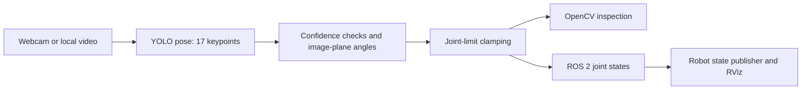

# Human to Humanoid Motion


> Turn camera-based human pose estimates into joint states for a humanoid visualization.

An independent computer vision and robotics project by **Yujun (Amy) Ge**. The pipeline detects a person, maps visible limb keypoints to constrained joint angles, and displays the result in OpenCV or publishes it to ROS 2 for RViz.

## The problem

A camera sees pixels, while a robot expects named joints with valid angle ranges. This prototype makes that interface inspectable: which keypoints are visible, what angles they produce, and which joint limits constrain the output.



## Implemented

| Component | Behavior |
| --- | --- |
| Pose estimation | YOLOv8 pose; selects the person with the highest mean keypoint confidence. |
| Mapping | Image-plane limb angles, confidence gating, and explicit joint limits. |
| Built-in robot | A mesh-free humanoid URDF with eight actuated joints. |
| Desktop preview | Keypoints, skeleton, and joint-angle overlays without ROS. |
| ROS output | `/joint_states` and a transient-local `/robot_description` topic. |
| Optional expression experiment | DeepFace labels mapped into expression commands in the desktop preview; separate from body mapping. |

## Quickstart

Python 3.10+ is required. Run commands from the repository root.

```bash
git clone https://github.com/YujunGe07/human-to-humanoid-motion.git
cd human-to-humanoid-motion
python3 -m venv .venv
source .venv/bin/activate
pip install -r requirements.txt

# Uses a local camera. The YOLO weights download on first use.
python src/test_no_ros.py --camera

# Or use your own video.
python src/test_no_ros.py --video /path/to/stroke-or-motion.mp4
```

Press `q` in the preview to quit. Local video files and model weights are excluded from Git.

### ROS 2 and RViz

Use Linux with ROS 2 Humble or Jazzy, `robot_state_publisher`, and RViz installed. Source the matching ROS setup in every terminal. ROS packages are installed through ROS, not pip.

```bash
# Terminal 1: publish mapped joint angles.
python src/main.py --camera --robot simple

# Terminal 2: publish the transforms that RViz needs.
ros2 run robot_state_publisher robot_state_publisher \
  --ros-args -p robot_description:="$(cat robot/humanoid.urdf)"

# Terminal 3: visualize the robot.
rviz2 -d config/robot_view.rviz
```

The built-in `simple` model is the supported mapping target. `robot_registry.py` also lists optional Unitree model paths, but those models require their own downloads, joint-name mapping, and validation before use.

### Optional expression experiment

```bash
pip install -r requirements-expression.txt
python src/test_no_ros.py --camera --emotion --show-expression
```

Facial expression labels are model predictions, not measurements of a person's internal state. Expression commands are displayed locally; publishing them to robot topics remains future work.

## Scope and limitations

This is a **2D geometric mapping prototype**. Image-plane angles depend on the camera view. Hidden limbs default to zero; hip angles use a knee-based heuristic. The project does not reconstruct metric 3D pose, solve full-body inverse kinematics, enforce balance, or control physical hardware. No tracking accuracy or latency benchmark is claimed.

The public copy contains the independent pose and visualization pipeline. It does not include employer or lab source code, recordings, model checkpoints, or third-party robot meshes.

## Repository structure

```text
src/       Pose detection, geometry, overlays, and ROS publishing
robot/     Built-in humanoid.urdf
config/    RViz display configuration
tests/     Geometry, confidence, and URDF contract checks
```

## Validation

```bash
python -m unittest discover -s tests -v
```

The tests exercise geometry, confidence gating, finite bounded outputs, and agreement between mapped joint names and the URDF. They require NumPy but do not load YOLO weights or open a camera. Live camera inference and ROS visualization require the corresponding hardware and environment.

## Next steps

- Calibrate image-plane angles against the URDF's zero configuration.
- Add temporal smoothing and explicit handling of occluded limbs.
- Measure joint error and frame latency on a documented recording.
- Add per-robot joint mappings before trying other embodiments.

## Dependencies and attribution

Pose inference uses [Ultralytics YOLO](https://github.com/ultralytics/ultralytics); users should review its license for their intended use. Optional facial classification uses [DeepFace](https://github.com/serengil/deepface). Optional robot paths refer to [Unitree ROS models](https://github.com/unitreerobotics/unitree_ros), which are not redistributed here.

**Yujun (Amy) Ge** · [GitHub](https://github.com/YujunGe07) · [Email](mailto:yujunge@stanford.edu)
